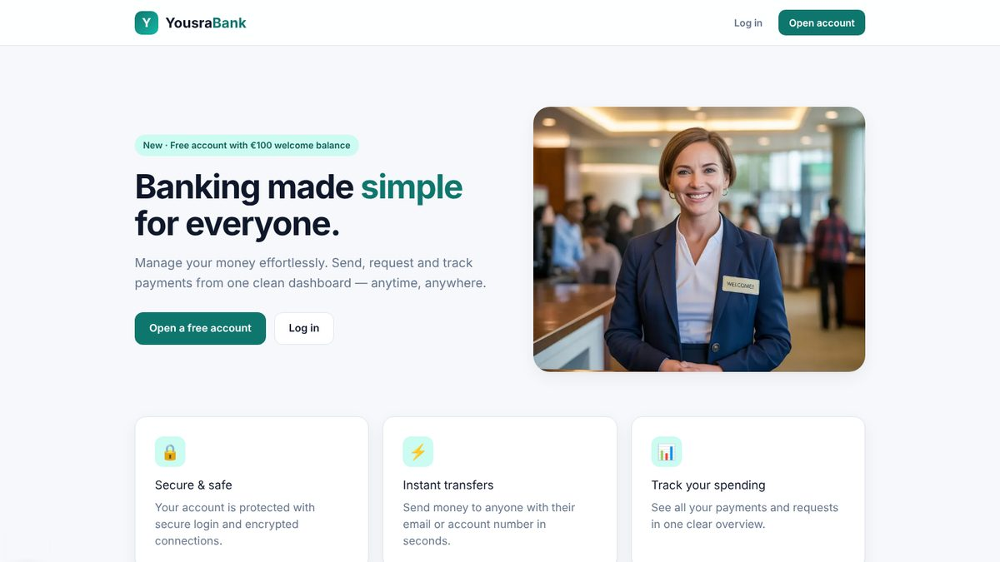
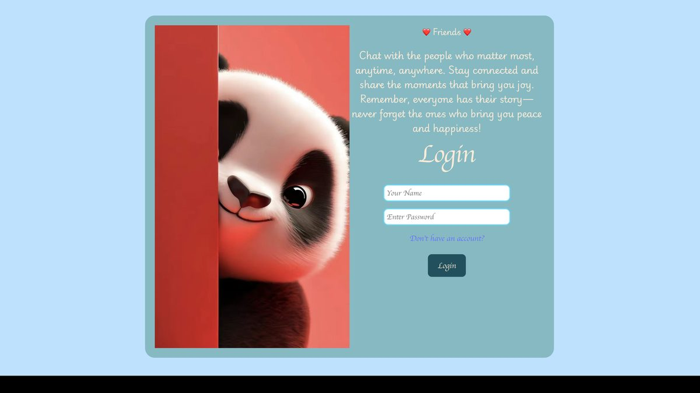
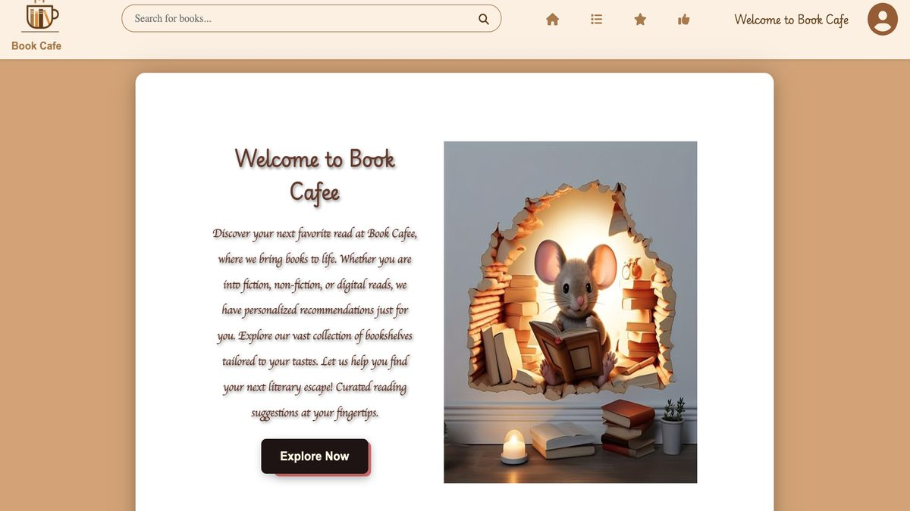
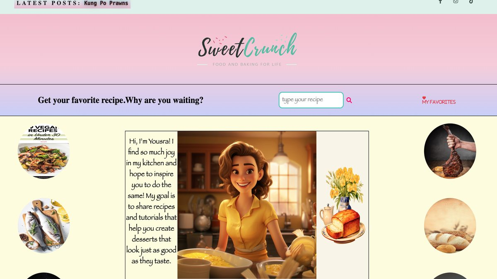
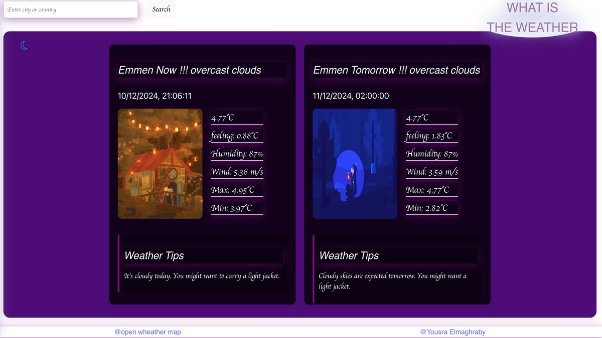
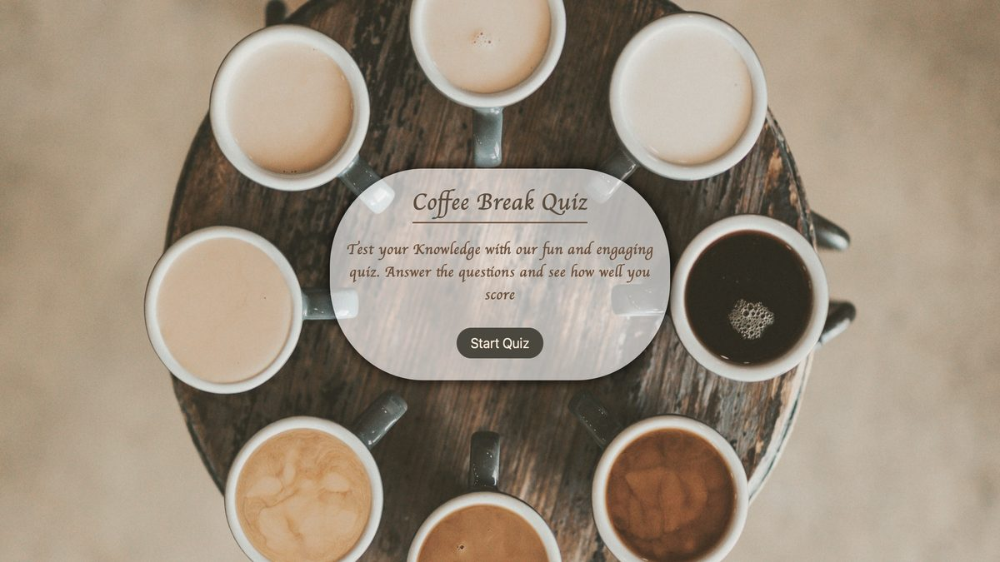
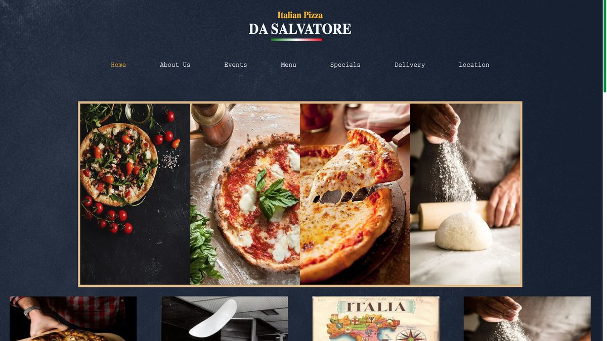
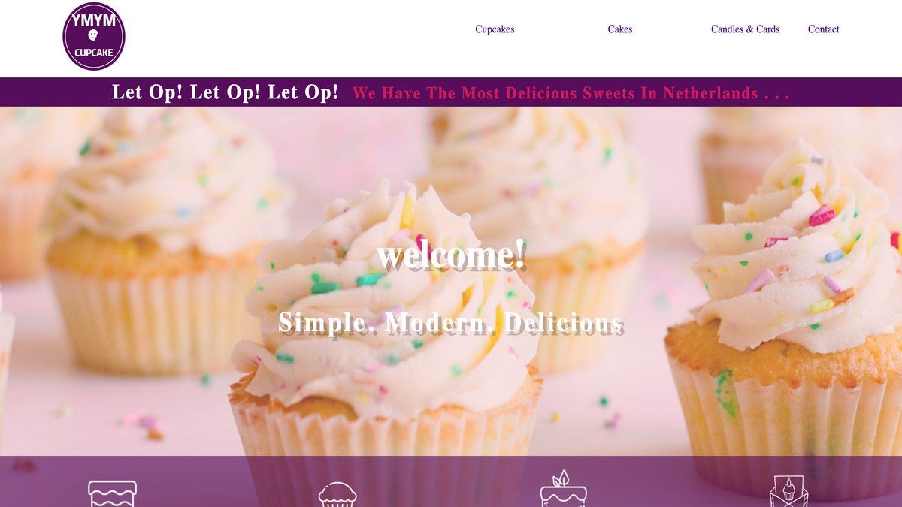

<h1 align="center">Hi, I'm Yousra Elmaghraby 👋</h1>

  <b>Full Stack Web Developer</b> · JavaScript · React · Node.js · TypeScript

  
  
  

---

## About me

I'm a full stack web developer with a background in **archaeology**. Archaeology taught me to work carefully with details, to document my work, and to solve problems step by step. Today I use the same skills to build clean, user-friendly web applications.

- 🎓 Trained as a developer at [HackYourFuture](https://www.hackyourfuture.net/)
- 💻 I build full stack apps with **React, Next.js, TypeScript, Node.js, Express, MongoDB and PostgreSQL**
- 🌱 Currently learning: **cybersecurity** — networking, cryptography, secure coding and tools like Nmap and Wireshark
- 🤝 Open to junior developer roles and collaborations

## Tech stack

**Languages** 

**Front-end** 

**Back-end & databases** 

**Testing & tools** 

## Featured projects

<table>
  <tr>
    <td width="50%" valign="top">
      
      <h3>Yousra Bank</h3>
      
Full stack banking app: register, check your balance and history, send and request money. Next.js, TypeScript, Express, PostgreSQL with Prisma, Supabase auth, tested with Jest.

      <a href="https://yousra-bank.vercel.app">Live demo</a> · <a href="https://github.com/YousraElmag/YousraBank">Source code</a>
    </td>
    <td width="50%" valign="top">
      
      <h3>Friends</h3>
      
Full stack chat app built with React, Express and MongoDB. Users sign up and log in with JWT authentication, search for friends and send messages with emojis.

      <a href="https://frinds-1imb.onrender.com/">Live demo</a> · <a href="https://github.com/YousraElmag/-friends-">Source code</a>
    </td>
  </tr>
  <tr>
    <td width="50%" valign="top">
      
      <h3>Book Cafe</h3>
      
Full stack book platform: search books, browse categories and save your favorites. Client on Netlify, API on Render.

      <a href="https://bookcafe2.netlify.app/">Live demo</a> · <a href="https://github.com/YousraElmag/Book-Cafe-">Source code</a>
    </td>
    <td width="50%" valign="top">
      
      <h3>Sweet Crunch</h3>
      
Recipe app to search recipes, get meal ideas and save your favorites.

      <a href="https://sweet-crunch-recipe-app.netlify.app/">Live demo</a> · <a href="https://github.com/YousraElmag/Sweet-Crunch-recipe-app">Source code</a>
    </td>
  </tr>
  <tr>
    <td width="50%" valign="top">
      
      <h3>What Is The Weather</h3>
      
Weather app for any city: current weather, tomorrow's forecast and practical tips. Uses the OpenWeatherMap API.

      <a href="https://yousrweather.netlify.app/">Live demo</a> · <a href="https://github.com/YousraElmag/WHAT_IS_THE-WEATHER">Source code</a>
    </td>
    <td width="50%" valign="top">
      
      <h3>Coffee Break Quiz</h3>
      
Interactive browser quiz about coffee with score tracking.

      <a href="https://coffee-break-app.netlify.app/">Live demo</a> · <a href="https://github.com/YousraElmag/hyf-c48-w2-browsers-quiz-app-coffee-break">Source code</a>
    </td>
  </tr>
  <tr>
    <td width="50%" valign="top">
      
      <h3>Da Salvatore</h3>
      
Website for an Italian pizza restaurant with menu, specials, events and location.

      <a href="https://da-salvatore.netlify.app/">Live demo</a> · <a href="https://github.com/YousraElmag/DA-SALVATORE">Source code</a>
    </td>
    <td width="50%" valign="top">
      
      <h3>YMYM Cupcake</h3>
      
Website for a cupcake and dessert shop with product categories and contact page.

      <a href="https://ymym-cupcake.netlify.app/">Live demo</a> · <a href="https://github.com/YousraElmag/YMYM-cupcake">Source code</a>
    </td>
  </tr>
</table>

## Let's connect

I'm always happy to talk about web development, junior roles or interesting projects.
Reach me on [LinkedIn](https://www.linkedin.com/in/yousra-elmaghraby/) or by [email](mailto:yousra3489@gmail.com).
